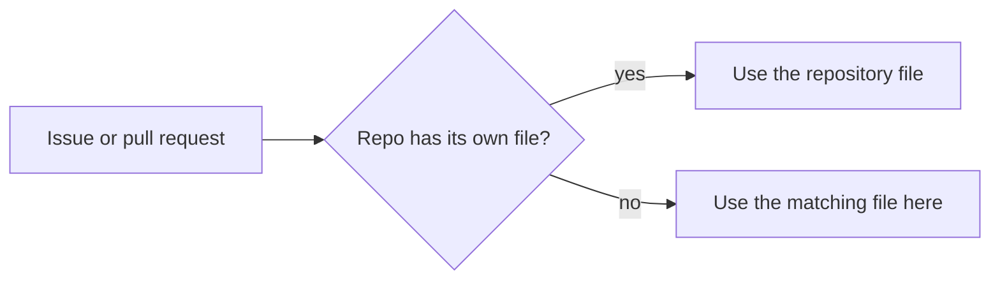

# .github

[**中文**](./README.zh.md)

Default community health files for the [Slahser](https://github.com/Slahser) account.

GitHub reads this public repository when another repository under the same account has no file of its own for a supported type. A repository that defines the file itself wins. For files GitHub accepts in more than one place, it checks `.github/`, then the repository root, then `docs/`. Files stored here are not copied into other repositories' clones or packages.

This is the mechanism described in [Creating a default community health file](https://docs.github.com/en/communities/setting-up-your-project-for-healthy-contributions/creating-a-default-community-health-file). The files in this tree are placeholders. They do not state a code of conduct, a contribution process, or a support channel.

## Files

| Path | What is in the tree |
| --- | --- |
| `CODE_OF_CONDUCT.md` | One line: `CODE_OF_CONDUCT.md here`. |
| `CONTRIBUTING.md` | One line: `CONTRIBUTING.md here.` |
| `SUPPORT.md` | One line: `SUPPORT.md here`. |
| `ISSUE_TEMPLATE/config.yml` | Sets `blank_issues_enabled: false` and lists two contact links. |
| `PULL_REQUEST_TEMPLATE/config.yml` | Empty file. |

`ISSUE_TEMPLATE/config.yml` points at [github.community](https://github.community/) and the [GitHub Security Bug Bounty](https://bounty.github.com/). Those are GitHub's own destinations, not a contact path for this account. A repository that keeps its own `.github/ISSUE_TEMPLATE` does not inherit this file.

There is no license file in this repository.
