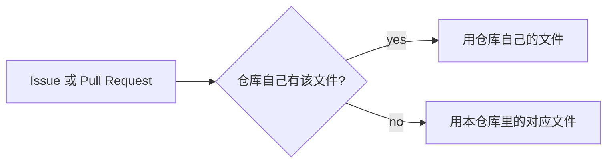

# .github

[English](./README.md)

[Slahser](https://github.com/Slahser) 账号的默认社区健康文件仓库。

同一账号下的其他仓库若没有某一类支持文件，GitHub 会读取这个公开仓库里的对应文件。仓库自己定义了该文件时，以自己的为准。对于允许放在多处的文件，查找顺序是 `.github/`、仓库根目录、`docs/`。这里的文件不会进入其他仓库的克隆或发行包。

机制见 [Creating a default community health file](https://docs.github.com/en/communities/setting-up-your-project-for-healthy-contributions/creating-a-default-community-health-file)。本仓库里的文件是占位，没有写行为准则、贡献流程或支持渠道。

## 文件

| 路径 | 仓库里的内容 |
| --- | --- |
| `CODE_OF_CONDUCT.md` | 一行：`CODE_OF_CONDUCT.md here`。 |
| `CONTRIBUTING.md` | 一行：`CONTRIBUTING.md here.` |
| `SUPPORT.md` | 一行：`SUPPORT.md here`。 |
| `ISSUE_TEMPLATE/config.yml` | 设置 `blank_issues_enabled: false`，并列出两个联系链接。 |
| `PULL_REQUEST_TEMPLATE/config.yml` | 空文件。 |

`ISSUE_TEMPLATE/config.yml` 指向 [github.community](https://github.community/) 和 [GitHub Security Bug Bounty](https://bounty.github.com/)。这两处是 GitHub 自己的目的地，不是本账号的联系方式。仓库若保留自己的 `.github/ISSUE_TEMPLATE`，就不会继承这个文件。

本仓库没有许可证文件。
